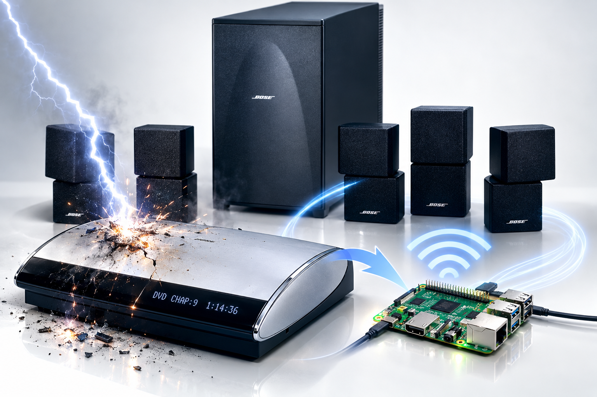

# Bose-Pi

**Giving a classic Bose Lifestyle 28 sound system a second life with a Raspberry Pi.**

Bose-Pi replaces the failed Bose AV28 central console with a Raspberry Pi 5, bringing network audio streaming and a custom SmartSpeaker Bus interface to the original Bose Lifestyle 28 speaker installation.

> Keep the speakers. Replace the brain. Let the music play again.

## The Story

About twenty years ago, we installed a Bose Lifestyle 28 home cinema system in our house. It consisted of five satellite speakers, a PS28 powered bass module, and an AV28 central console. The speakers were permanently wired into the house and mounted high on the walls.

Later, an Apple AirPort Express provided network music streaming through its digital audio output.

The system worked for many years. Then an indirect lightning strike destroyed the AV28 console. The speakers, PS28 bass module, and existing speaker wiring survived, but without the central console, the installation could no longer be used as intended.

Replacing the entire system seemed unnecessary. The speakers were still in place, the wiring was intact, and the original bass module remained available.

The Bose-Pi project started with a simple question:

**Could a Raspberry Pi replace the failed AV28 console and bring the existing system back to life?**

The answer is a working hardware and software solution that combines network audio playback with a separate interface to the Bose SmartSpeaker Bus.

## The Solution

The Raspberry Pi 5 takes over the relevant functions of the missing central console. It provides network audio playback and communicates with the PS28 through a custom-built interface.

The solution has three distinct parts:

- **Audio playback:** AirPlay audio is received by Shairport Sync and passed through ALSA to an INNO-MAKER Digi One HAT, which provides the S/PDIF digital audio output.
- **Bose control:** A Raspberry Pi UART interface connects to the Bose SmartSpeaker Bus through an SN74HC07N open-collector interface.
- **Passive monitoring:** A separate GPIO input is used to observe bus traffic without transmitting commands.

The original PS28 does not need to be opened or internally modified. The existing satellite speakers and their wiring can remain in place.

## System Architecture

### Audio path

`iPhone / Mac → AirPlay → Shairport Sync → ALSA → INNO-MAKER Digi One → S/PDIF → Bose PS28`

### Control path

`Raspberry Pi UART0 → SN74HC07N interface → Bose SmartSpeaker Bus → Bose PS28`

The passive bus sniffer uses a separate Raspberry Pi GPIO input. It is distinct from the active UART communication path.

The project uses the **normal SmartSpeaker operating mode**. TAP mode is not used.

## Hardware

The documented hardware consists of:

- Raspberry Pi 5 Model B
- INNO-MAKER Digi One HAT for S/PDIF digital audio output
- GeeekPi prototype breakout board
- SN74HC07N open-collector buffer
- Wiring and connectors for the SmartSpeaker Bus interface
- Bose Lifestyle 28 AV28/PS28 system with five satellite speakers

The connection between the Raspberry Pi interface and the PS28 uses a standard network cable for the project-specific signals. **It is not an Ethernet connection.**

Refer to the hardware documentation and reference wiring diagram before assembling the interface.

## Software

The software separates audio playback, serial communication, SmartSpeaker Bus handling, and system control.

The Raspberry Pi runs Debian GNU/Linux 13 (trixie). The Bose serial interface uses UART0:

- Device: `/dev/ttyAMA0`
- TX: GPIO14, physical pin 8
- RX: GPIO15, physical pin 10
- Serial format: 4800 baud, 8 data bits, no parity, 1 stop bit (8N1)

The passive sniffer uses GPIO16 to observe bus activity independently of the active UART interface.

See the software documentation for the implementation details and the state-machine description.

## Documentation

The [`docs/`](docs/README.md) directory contains the technical documentation.

- [Documentation Index](docs/README.md) — Overview of the documentation.
- [System Architecture](docs/architecture.md) — Components and signal paths.
- [Hardware](docs/hardware.md) — Hardware components, interfaces, and electrical design.
- [Hardware Build Guide](docs/hardware/build-guide.md) — Assembly instructions.
- [Reference Wiring](docs/hardware/reference-wiring.md) — Wiring reference for the hardware interface.
- [SmartSpeaker Bus](docs/smartspeaker-bus.md) — Bus communication and protocol observations.
- [Control Software](docs/control-software.md) — Software components and their responsibilities.
- [Operating Mode](docs/operating-mode.md) — Runtime behaviour and operating conditions.
- [State Machine](docs/state-machine.md) — System states and transitions.
- [Enclosure Design](docs/enclosure.md) — Mechanical integration and enclosure design.

## Project Scope

Bose-Pi is a focused replacement for the failed central console, not a complete reimplementation of every feature of the original Bose Lifestyle system.

The project documents the hardware, software, observed bus traffic, and behaviour verified on the actual installation. Protocol interpretations are distinguished from directly observed or tested behaviour.

The aim is to provide enough practical information for others to understand the design, reproduce the hardware interface, and build on the documented implementation.

## Acknowledgements

**Kenneract — [Bose-Reverse-Engineering](https://github.com/Kenneract/Bose-Reverse-Engineering)**

This project acknowledges the valuable reverse-engineering work published by Kenneract on the Bose 3·2·1 GS Series III system, particularly the investigation of the Bose SmartSpeaker protocol.

That work provides useful technical background for understanding the bus architecture and serial communication. Bose-Pi is an independent project, and its hardware, measurements, and implementation are documented separately.

We gratefully acknowledge Kenneract's contribution to the Bose reverse-engineering community.

## Disclaimer

Bose-Pi is an independent, unofficial project and is not affiliated with, endorsed by, or supported by Bose. Bose and Lifestyle are trademarks of their respective owners.
