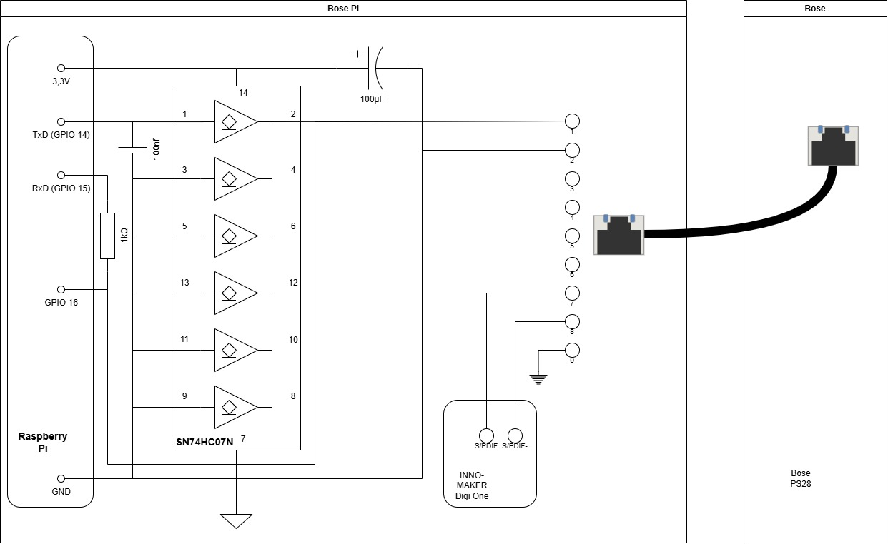
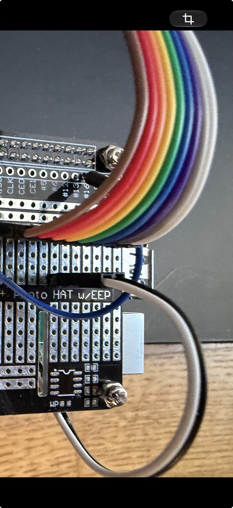

# Hardware Build Guide

This guide documents the external Bose-Pi adapter for a Bose Lifestyle 28 system with an AV28 console and PS28 powered bass module.

The adapter replaces selected functions of the failed AV28 console. The PS28 remains closed and internally unmodified.

> **Mandatory operating constraint: normal SmartSpeaker mode only. TAP mode is excluded.** Do not connect TAP contacts or send TAP mode-entry commands.

## 1. Adapter Functions

The adapter provides two main functions:

1. Digital audio output from the Raspberry Pi to the Bose PS28.
2. An electrical interface between the Raspberry Pi UART and the Bose SmartSpeaker Bus.

A separate GPIO input supports passive bus monitoring.

The audio output and SmartSpeaker Bus interface are independent signal paths.

The cable between the adapter and the PS28 is a standard network cable used for project-specific signals. It is not an Ethernet connection and must never be connected to a network switch.

## 2. Bill of Materials

| Item | Quantity | Purpose |
|---|---:|---|
| Raspberry Pi 5 Model B | 1 | Main computing platform |
| INNO-MAKER Digi One HAT | 1 | S/PDIF digital audio output |
| SN74HC07N, DIP-14 | 1 | Open-collector buffer |
| 100 nF capacitor | 1 | Local supply decoupling |
| 100 µF capacitor | 1 | Additional supply buffering |
| 1 kΩ resistor | 1 | Series resistor in the documented receiver path |
| Prototype HAT / perfboard | 1 | Interface circuit and removable connections |
| Jumper wires and connectors | As required | Electrical connections |
| 8-pin RJ45 breakout board | 1 | Cable connection to the PS28 |
| Standard network cable | 1 | Multi-conductor signal cable |
| Suitable Raspberry Pi power supply | 1 | Power for the Raspberry Pi and attached hardware |

The component arrangement and electrical connections must match the project's reference wiring diagram.

## 3. Reference Wiring

Use the following documents together:

- [Reference Wiring and Connector Notes](reference-wiring.md)
- [Reference Wiring Diagram](../images/bose-pi-reference-wiring.jpg)



The reference diagram defines the physical connections for the documented build. Do not substitute a generic Ethernet pinout or infer connector contact numbering from cable colours.

## 4. Raspberry Pi Connections

The documented UART and monitoring assignments are:

| Raspberry Pi signal | Physical pin | Function |
|---|---:|---|
| GPIO14 / UART0 TX | 8 | UART transmit to the SN74HC07N input |
| GPIO15 / UART0 RX | 10 | UART receive path |
| GPIO16 | 36 | Passive bus monitoring input |
| 3.3 V | 1 or 17 | SN74HC07N supply |
| GND | As shown in the diagram | Common signal reference |

The UART device used by the tested software is `/dev/ttyAMA0`.

The serial console must not transmit boot or login text through the UART connected to the Bose interface.

Verify the UART configuration and GPIO mapping on the actual Raspberry Pi before connecting the interface to the PS28.

## 5. Assemble the SN74HC07N Interface

The SN74HC07N is a hex buffer with open-collector outputs. The documented circuit uses it to pull the shared SmartSpeaker DATA line LOW without actively driving the line HIGH.

| SN74HC07N pin | Connection |
|---|---|
| 1 | GPIO14 / UART0 TX |
| 2 | SmartSpeaker DATA line |
| 7 | GND |
| 14 | Raspberry Pi 3.3 V |

### Assembly requirements

- Fit a 100 nF decoupling capacitor directly between pins 14 and 7.
- Fit the documented 100 µF supply-buffering capacitor, observing polarity if an electrolytic capacitor is used.
- Tie all unused gate inputs to GND. Leave their outputs unconnected.
- Preserve the documented 3.3 V bus pull-up arrangement.
- Do not add another pull-up without a demonstrated electrical reason.
- Never connect a Raspberry Pi push-pull GPIO directly to the shared SmartSpeaker DATA line.

The documented circuit identifies R25 as a 10 kΩ pull-up and R650 as a 510 Ω component in the signal path. Preserve their positions and connections as shown in the reference diagram.

The receiver path includes the documented 1 kΩ series resistor. GPIO15 and GPIO16 connections must follow the reference diagram and the known-good physical build.

**The pin table above is not a complete schematic.** Use the reference diagram for the complete circuit, including all resistors, capacitors, signal paths, and connector contacts.

## 6. Modify the INNO-MAKER Digi One Audio Output

The reference build removes the Digi One's original RCA connector and connects two insulated wires to the corresponding S/PDIF output points.



Assembly procedure:

1. Identify the two S/PDIF output points on the actual Digi One board revision.
2. Remove the original RCA connector without damaging nearby pads or traces.
3. Solder two insulated wires to the corresponding electrical output points.
4. Insulate the connections and provide strain relief.
5. Route the wires to the removable jumper connections on the interface HAT.
6. Check continuity and verify that neither signal is shorted to ground or a supply rail.

The PS28 input uses a transformer-coupled differential S/PDIF interface as described in the referenced Bose documentation. Preserve the verified signal-pair mapping.

Do not arbitrarily connect either S/PDIF signal wire to ground.

## 7. Cable and PS28 Connector

Use a standard network cable between the Bose-Pi adapter and the PS28's normal system connector.

The cable carries project-specific signals rather than Ethernet traffic.

The reference diagram defines:

- SmartSpeaker DATA and the associated interface connections.
- Signal ground/reference.
- The two S/PDIF wires, connected to positions 7 and 8 as shown in the project drawing.
- TAP-related contacts, which remain unconnected.

Connector contact numbering depends on viewing orientation. Confirm the connector orientation and check cable continuity with a meter before connecting the adapter to the PS28.

Do not rely on cable colours or a generic Ethernet pinout.

## 8. UART Configuration

The tested serial configuration is:

| Parameter | Value |
|---|---|
| Linux device | `/dev/ttyAMA0` |
| Baud rate | 4800 |
| Data bits | 8 |
| Parity | None |
| Stop bits | 1 |
| Framing | 8N1 |

Example configuration using PySerial:

```python
import serial

ser = serial.Serial(
    port="/dev/ttyAMA0",
    baudrate=4800,
    bytesize=serial.EIGHTBITS,
    parity=serial.PARITY_NONE,
    stopbits=serial.STOPBITS_ONE,
    timeout=0,
)
```

This example configures the UART only. It is not a complete implementation of the Bose protocol or the system controller.

## 9. Passive Bus Monitoring

The passive sniffer is implemented in `scripts/ps28_sniffer.py`.

It uses GPIO16 (physical pin 36) and the GPIO interface to capture bus activity. The configured serial timing assumption is 4800 baud, 8N1.

The sniffer groups captured activity into bursts using an idle-gap setting. This software grouping parameter must not be interpreted as proof of a protocol-defined message boundary.

GPIO15 and GPIO16 are connected through the documented receiver arrangement, including the 1 kΩ series resistor.

The passive sniffer is a diagnostic tool. It is not the active UART transmitter and must not be described as transmitting Bose commands.

Avoid conflicting GPIO ownership when running diagnostic tools. Do not start multiple processes that request the same GPIO line exclusively.

## 10. Pre-Power Checklist

Before connecting the adapter to the PS28:

- [ ] Verify SN74HC07N pin 14 is connected to 3.3 V.
- [ ] Verify SN74HC07N pin 7 is connected to GND.
- [ ] Check the 100 nF decoupling capacitor.
- [ ] Check the polarity of the 100 µF capacitor, if applicable.
- [ ] Verify all unused SN74HC07N gate inputs are tied to GND and their outputs are unconnected.
- [ ] Verify GPIO14 connects to IC pin 1 and IC pin 2 connects to SmartSpeaker DATA.
- [ ] Verify the documented pull-up and receiver-resistor paths against the reference diagram.
- [ ] Verify the GPIO15 and GPIO16 receiver/monitoring connections.
- [ ] Check that the S/PDIF pair has no short to ground or the supply rails.
- [ ] Verify the cable contact mapping and connector orientation.
- [ ] Confirm the cable is not connected to an Ethernet switch.
- [ ] Confirm that TAP contacts remain unconnected.
- [ ] Check that no Raspberry Pi GPIO is exposed to an unsafe voltage.

Do not connect the adapter to the Bose equipment until the wiring and power connections have been checked.

## 11. Validation

Validate the hardware paths independently.

### Digital audio

1. Start the Raspberry Pi and the configured AirPlay audio service.
2. Verify that the INNO-MAKER Digi One provides the expected digital audio output.
3. Test playback through the PS28 and the existing speakers.

Audible AirPlay playback through the documented audio path has been verified on the project installation.

### UART and SmartSpeaker Bus

1. Verify the UART device and serial settings.
2. Use the documented passive sniffer to observe bus activity when appropriate.
3. Test bus queries only with the established project test procedure.
4. Compare captured bytes with the documented observations.

The tested serial configuration is `/dev/ttyAMA0`, 4800 baud, 8N1. The observed responses and tested commands are documented in the SmartSpeaker Bus documentation.

The active Bose-Pi controller monitors GPIO16 and processes AirPlay START and STOP events. On START, it sends the `ANTI_MUTE` and `FIVE_CHANNEL` commands. On STOP, it schedules `MUTE` after 5 seconds and `POWER_OFF` after a total of 10 seconds. A new START cancels the pending STOP sequence.

At startup, the controller checks Bose bus availability using the documented status query. This is a startup check, not periodic polling.

The standalone UART diagnostic scripts must not be run while the controller service is active, because both use `/dev/ttyAMA0`.

## 12. Operating Mode

Bose-Pi uses the normal SmartSpeaker operating mode exclusively.

TAP mode is not part of the build, startup, operation, troubleshooting, or recovery procedure. Leave TAP contacts unconnected and do not send TAP mode-entry commands.

## 13. Manufacturer Documentation

The following documents were used as technical references:

- *PS18/28/35 Troubleshooting Guide*, section 2.4, “Serial data interface, SmartSpeaker and TAP”, page 13.
- Schematic SD267086, sheet 1 of 8.
- Earlier comparison schematic SD254175, sheet 1 of 8.

This repository documents the project's own hardware implementation and measurements. Refer to the original manufacturer documentation for the complete original circuit and service information.
