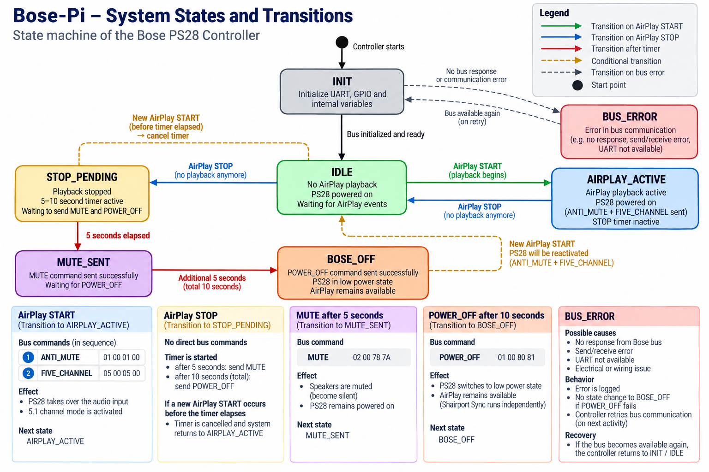

# Software State Machine

## 1. Purpose

The Bose-Pi state machine coordinates AirPlay playback events, SmartSpeaker Bus communication, and delayed Bose shutdown actions.

The implementation runs on a Raspberry Pi 5 and replaces selected functions of the original Bose AV28 central console in a Bose Lifestyle 28 system.

The state machine coordinates the following functions:

- AirPlay START and STOP event handling.
- SmartSpeaker Bus availability checking.
- Active UART communication with the Bose PS28.
- Playback setup commands.
- Delayed MUTE and POWER_OFF actions.
- Cancellation of pending shutdown actions when playback starts again.
- State and event logging.

Passive SmartSpeaker Bus monitoring is a separate diagnostic function.

## 2. Verified System Components

The documented system uses:

- Raspberry Pi 5 Model B.
- Debian GNU/Linux 13 (trixie).
- Shairport Sync for AirPlay playback.
- ALSA and the INNO-MAKER Digi One HAT for digital audio output.
- UART0 at `/dev/ttyAMA0`, using GPIO14 TX and GPIO15 RX.
- A custom SN74HC07N open-collector interface.
- GPIO16 for passive SmartSpeaker Bus monitoring.

The serial configuration is 4800 baud, 8 data bits, no parity, and 1 stop bit (8N1).

The audio path and active control path are independent. The passive sniffer does not transmit Bose commands.

## 3. Operational States

The following states describe the controller's operational behaviour.

| State | Description |
|---|---|
| `INIT` | The controller initializes its configuration and required interfaces. |
| `BOSE_UNAVAILABLE` | The Bose system is not available according to the controller's availability checks. |
| `AVAILABLE_IDLE` | The Bose system is available and no AirPlay playback session is active. |
| `AIRPLAY_ACTIVE` | An AirPlay playback session is active and the playback setup sequence has been executed. |
| `STOP_PENDING` | AirPlay playback has stopped and the delayed shutdown sequence is pending. |
| `MUTED_IDLE` | The MUTE stage has completed; POWER_OFF is still pending. |
| `BOSE_OFF` | The POWER_OFF stage has completed. |
| `BUS_ERROR` | A bus communication error has been detected by the relevant error-handling path. |

The state names represent controller states. They do not imply that the Raspberry Pi itself is powered off when the controller enters `BOSE_OFF`.

## 4. START Sequence

When the controller receives a new AirPlay START event, it cancels any pending STOP sequence.

It then executes the playback setup sequence:

1. Send ANTI_MUTE.
2. Send FIVE_CHANNEL.
3. Enter the active playback state.
4. Record the relevant state and event information.

The tested command frames are:

```text
ANTI_MUTE:    01 00 01 00
FIVE_CHANNEL: 05 00 05 00
```

The complete playback setup sequence has been verified on the actual Bose Lifestyle 28 installation.

## 5. STOP Sequence

When the controller receives an AirPlay STOP event, it enters `STOP_PENDING` and starts the delayed shutdown sequence.

The timers are measured from the original STOP event.

| Time from STOP | Action | Command |
|---:|---|---|
| 0 seconds | Enter `STOP_PENDING` | — |
| 5 seconds | Send MUTE | `02 00 78 7A` |
| 10 seconds total | Send POWER_OFF | `01 00 80 81` |

After the MUTE stage, the controller enters `MUTED_IDLE`. After the POWER_OFF stage, it enters `BOSE_OFF`.

The complete sequence, including MUTE and POWER_OFF, has been verified on the actual hardware.

The POWER_OFF state describes the Bose system's operating state. AirPlay and the Raspberry Pi remain available for a subsequent playback session.

## 6. Cancellation on a New START

A new START event received while the controller is in `STOP_PENDING` or `MUTED_IDLE` cancels the outstanding shutdown sequence.

The controller must not execute a stale timer action after the new playback session has started.

The transition is:

```text
STOP_PENDING or MUTED_IDLE
             |
             | New START
             v
Cancel pending shutdown actions
             |
             v
Send ANTI_MUTE
             |
             v
Send FIVE_CHANNEL
             |
             v
AIRPLAY_ACTIVE
```

This behaviour prevents a delayed MUTE or POWER_OFF action from interrupting a new playback session.

## 7. State Transitions

The main operational transitions are:

| Current state | Event or condition | Action | Next state |
|---|---|---|---|
| `INIT` | Initialization complete; Bose available | Complete startup checks | `AVAILABLE_IDLE` |
| `INIT` | Bose unavailable | Record availability result | `BOSE_UNAVAILABLE` |
| `BOSE_UNAVAILABLE` | Bose becomes available and checks succeed | Update availability | `AVAILABLE_IDLE` |
| `AVAILABLE_IDLE` | AirPlay START | Send ANTI_MUTE and FIVE_CHANNEL | `AIRPLAY_ACTIVE` |
| `AIRPLAY_ACTIVE` | AirPlay STOP | Start shutdown timers | `STOP_PENDING` |
| `STOP_PENDING` | Five seconds elapsed | Send MUTE | `MUTED_IDLE` |
| `MUTED_IDLE` | Ten seconds elapsed from STOP | Send POWER_OFF | `BOSE_OFF` |
| `STOP_PENDING` | New AirPlay START | Cancel timers; execute START sequence | `AIRPLAY_ACTIVE` |
| `MUTED_IDLE` | New AirPlay START | Cancel remaining shutdown timer; execute START sequence | `AIRPLAY_ACTIVE` |
| Any applicable state | Bus communication error | Record error and handle according to the implementation | `BUS_ERROR` |

The table describes the intended operational transitions of the documented controller. Error recovery and transitions not listed here must follow the actual implementation rather than being inferred from the state names.

## 8. UART and SmartSpeaker Bus Handling

The active UART interface uses `/dev/ttyAMA0` at 4800 baud, 8N1.

The controller sends the required command frames through the documented electrical interface. UART transmission, UART reception, and passive GPIO monitoring are separate activities.

The passive sniffer captures bus activity through GPIO16. It is used for diagnostics and protocol observation, not as the active controller.

A successful UART write does not by itself prove that the PS28 executed a command. Command behaviour must be established through the verified hardware tests.

Likewise, captured bytes must not be assigned a protocol meaning or sender without sufficient evidence.

The electrical interface is documented in [Hardware](hardware.md) and [Reference Wiring](hardware/reference-wiring.md).

## 9. Audio-Service Handling

The audio path is:

`AirPlay → Shairport Sync → ALSA → INNO-MAKER Digi One → S/PDIF → Bose PS28`

The controller reacts to the playback-session events supplied by the configured Shairport Sync hooks.

The audio service and the Bose control state are related but distinct. A running Shairport Sync service does not prove that sound is currently audible, and a Bose state transition does not by itself prove that an AirPlay stream is active.

The automatic START/STOP control sequence has been verified on the actual installation.

## 10. Error Handling

The implementation must distinguish between the following error categories:

- Application initialization failure.
- UART initialization failure.
- Bose availability check failure.
- Bus communication timeout or invalid response.
- Audio-service failure.
- Unexpected controller events.

The relevant component should record diagnostic information so that the cause can be investigated.

An unavailable Bose system must not be treated as a successful control operation. Similarly, a running controller process must not be taken as proof of successful bus communication.

## 11. State-Machine Diagram

The state-machine diagram is maintained at:

[`docs/images/system-state-machine.png`](images/system-state-machine.png)



The diagram should be kept consistent with the states, events, timer sequence, and cancellation behaviour described in this document.

## 12. Validation

The following behaviour has been verified on the actual Bose Lifestyle 28 installation:

- AirPlay playback through the INNO-MAKER Digi One and the PS28.
- SmartSpeaker Bus communication using UART0 at 4800 baud, 8N1.
- Playback setup using ANTI_MUTE followed by FIVE_CHANNEL.
- Automatic MUTE five seconds after STOP.
- Automatic POWER_OFF ten seconds after STOP.
- Cancellation of the pending shutdown sequence when a new START occurs.
- Passive bus monitoring as a separate diagnostic function.

The documented behaviour reflects the working project implementation. It does not claim to describe every feature of the original Bose AV28 console or the complete Bose SmartSpeaker protocol.

## Related Documentation

- [System Architecture](architecture.md)
- [Hardware](hardware.md)
- [SmartSpeaker Bus](smartspeaker-bus.md)
- [Control Software](control-software.md)
- [Operating Mode](operating-mode.md)
